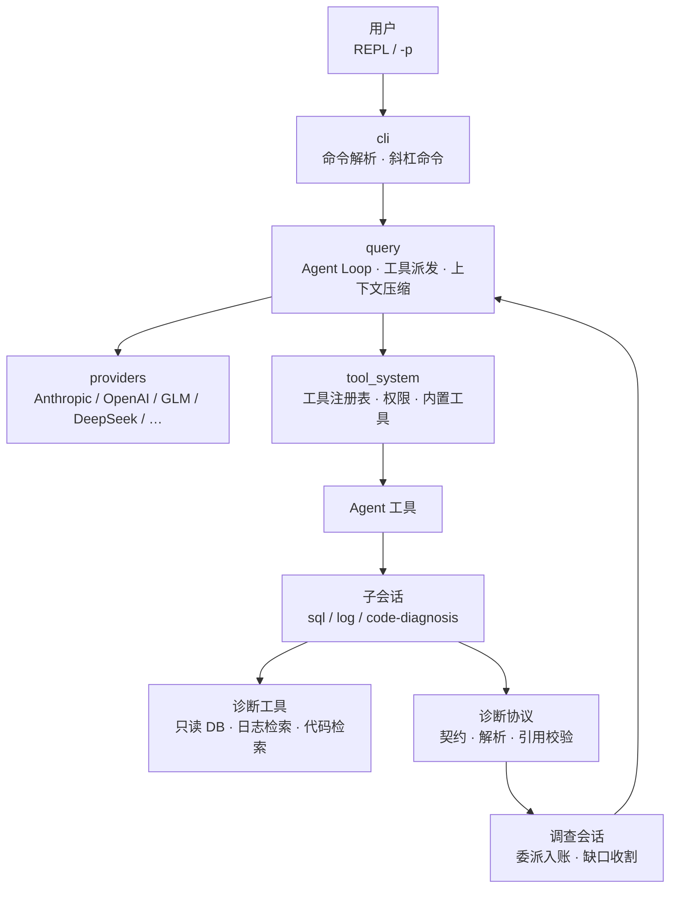
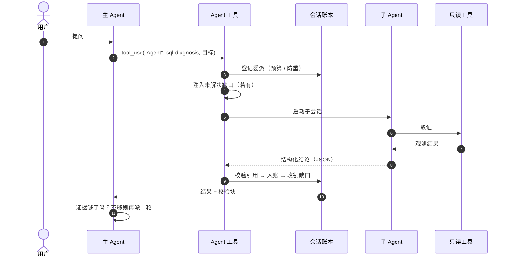

# 架构说明

## 分层



主 Agent 与子 Agent 共用同一个 Agent Loop 与同一套 Provider，
差别只有两处：**系统提示**与**可见工具集**。子 Agent 拿不到 `Agent` 工具，因此不能继续下派。

## 一次诊断的调用顺序



## 证据协议

子 Agent 不返回自由文本，而是一段可解析的 JSON：

```json
{
  "status": "success",
  "summary": "下游 orders 为空，调度未完成",
  "evidence": [
    {
      "evidence_id": "ev-1",
      "source_type": "sql",
      "observation": "secondary.orders count = 0",
      "proves": "下游 orders 表无数据",
      "cannot_prove": ["上游是否有数据"],
      "applicability": { "window": "2026-10-22 09:00-10:00", "tenant": "tenant-003" },
      "relation": [{ "kind": "complementary", "with": "ev-2" }]
    }
  ],
  "root_causes": [
    {
      "description": "调度窗口超时导致同步未进入落库阶段",
      "confidence": 0.85,
      "supporting_evidence_ids": ["ev-1", "ev-2"]
    }
  ],
  "recommendations": ["调整批次窗口或分批拉取"],
  "validation_plan": ["重跑增量后核对 secondary.orders 行数"],
  "limitations": ["未取得上游确切行数"],
  "next_steps": ["统计 primary.orders 行数"]
}
```

四个可选语义字段是这套协议的关键：

| 字段 | 回答的问题 |
|---|---|
| `proves` | 这条证据**直接证明**了什么命题 |
| `cannot_prove` | 它**不能**证明什么（防止过度外推） |
| `applicability` | 在什么条件下成立（时间窗 / 租户 / 过滤条件） |
| `relation` | 与其它证据的关系（`consistent` / `complementary` / `conflict`） |

缺失这些字段不会拒绝入账，只在评分时区分——否则模型会学会"不写最安全"。

## 缺口（gap）

子 Agent 会留下两类信息：`next_steps`（该查没查）与 `limitations`（查了没查清）。
编排层把它们收成"缺口"，带四种状态：

| 状态 | 含义 |
|---|---|
| `open` | 待取证 |
| `resolved` | 后续证据已覆盖 |
| `blocked` | 无法取证（如无权限） |
| `inconclusive` | 同一命题被反复提出仍未解决 |

下一轮派发时，最多 5 条 `open` 缺口会被追加进子 Agent 的提示，让它优先取证。
没有这套机制，多轮诊断就只是"再问一遍"，而不是"带着已知的未知去问"。

## 结论冲突

两个子 Agent 可能对同一对象给出相反判断（"orders 未落库" vs "orders 已同步"）。
处理方式是**检测但不裁决**：

| 情形 | 处理 |
|---|---|
| 跨子 Agent 冲突 | 标记 `unresolved`，`/tasks` 与报告并列呈现，不选边 |
| 同一子 Agent 内部矛盾 | 标记 `internal`，该结论置信度封顶 0.4 |

理由很直接：代码没有地面真值，替模型选边等于用工程手段掩盖不确定性。

## 扩展点

**加一个工具**：实现 `call()` 返回 `ToolResult`，注册到 registry，并在子 Agent 定义的工具列表里声明。

**加一个子 Agent**：

```python
@AgentRegistry.register(
    "my-diagnosis",
    when_to_use="当需要 … 时使用",
    tools=["Read", "Grep", "MyTool"],
    disallowed_tools=["Agent"],          # 不允许继续下派
    permission_mode="dontAsk",
)
def _prompt() -> str:
    ...
```

**加一个 Skill**：`cloudagent_ext/skills/bundled/<name>_resources/SKILL.md`，
写"怎么查"而不是"查什么"，由 Agent 按需加载。
