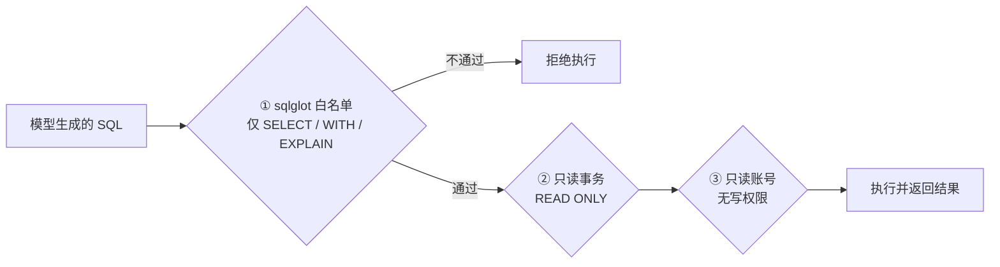

# 安全模型

## 定位

CloudAgent 连的是**准生产库、真实日志、业务代码**——它握着的权限比普通问答助手大得多。

因此设计上只有一句话：**能读，不能改。**

这不是靠提示词约束，而是三层强制。

## 只读三重防线



| 防线 | 位置 | 拦什么 |
|---|---|---|
| ① 语法白名单 | `diagnosis/db/sql_guard.py` | `INSERT` / `UPDATE` / `DELETE` / DDL / `COPY` / `CALL`；危险函数（`pg_read_file` 等） |
| ② 事务只读 | `diagnosis/db/tools.py` | 即使漏过语法检查，写操作也会被数据库拒绝 |
| ③ 账号权限 | 数据库（建库时授予） | 只读账号只有 `CONNECT` + `USAGE` + `SELECT` |

三层都必要：白名单挡"明显不该做的"，事务挡"漏网的"，账号挡"前两层都被绕过的"。

## 子 Agent 能看到什么

子 Agent 在 `dontAsk` 权限模式下运行：**不弹确认框，需要确认的操作直接 deny**。

| 子 Agent | 可用工具 | 不可用 |
|---|---|---|
| `sql-diagnosis` | `query_table_rows` / `get_schema` / `get_indexes` / `explain_sql` / `get_table_stats` / `get_lock_info` + `Read` / `Grep` / `Glob` / `Bash`（只读命令） | `Agent`、写文件、Bash 写操作 |
| `log-diagnosis` | `search_logs` / `get_log_context` / `parse_stack_trace` / `correlate_events` + 通用只读工具 | 同上 |
| `code-diagnosis` | `find_symbol` / `find_references` + `Read` / `Grep` / `Glob` / `Bash`（只读） | 同上 |

**子 Agent 拿不到 `Agent` 工具**，这是刻意的——防止无限下派。

工具白名单不仅展示层生效，**执行层同样强制**：即使模型试图调用列表外的工具，注册表边界也会拒绝。

## 它会写哪些文件

正面清单，仅四处：

| 路径 | 内容 |
|---|---|
| `~/.cloudagent/config.json` | 配置与凭据（仅 `cloudagent login` 写入） |
| `~/.cloudagent/projects/<repo>/memory/*.md` | 项目记忆 |
| `eval/runs/<run_id>/` | 评测报告 |
| 会话记录（`~/.cloudagent/projects/...`） | 对话历史 |

除此之外不写任何文件。若发现其它写入路径，属缺陷，请提 Issue。

## 权限模式

| 模式 | 行为 | 谁在用 |
|---|---|---|
| `default` | 写文件 / 执行命令需确认 | 交互式 CLI |
| `dontAsk` | 受限工具集 + 不确认，需确认的操作直接 deny | 诊断子会话 |
| `plan` | 只读探索 | 计划模式 |
| `acceptEdits` | 文件编辑自动通过 | 用户显式开启 |
| `bypassPermissions` | 全部放行（危险） | 需显式开关 |

## 凭据处理

| 项 | 处理 |
|---|---|
| 数据库 DSN | 只在 `config.json` 的 `env` 段或进程环境变量；不入库 |
| 模型 API Key | 由 `cloudagent login` 写入 `~/.cloudagent/` |
| 日志与报告 | 落盘前经 `redact_sensitive()` 脱敏（JSON 与 markdown 各一次） |

## 自查

```bash
# 只读对抗套件：越权工具、写操作、路径逃逸、提示注入
pytest tests/diagnosis/security -q

# 账号权限（应为只读）
# psql 内执行：
# SELECT grantee, privilege_type FROM information_schema.role_table_grants
# WHERE grantee = 'cloudagent_ro';

# 检查子 Agent 的权限模式
git grep -n "permission_mode" cloudagent_ext/agent/_bundled_agents/
```

## 已知边界

- **Bash 只读是"命令级"判断**，不是沙箱。若你把子 Agent 的 `Bash` 移除，边界会更硬。
- **提示注入**：日志与代码内容可能包含恶意指令。当前防护是"子 Agent 工具集本身受限"，
  即使被注入也改不了库；但可能诱导它做多余的读操作。
- **不做数据脱敏的反向保证**：报告会脱敏凭据，但业务字段（如租户名）不会被自动遮蔽。
